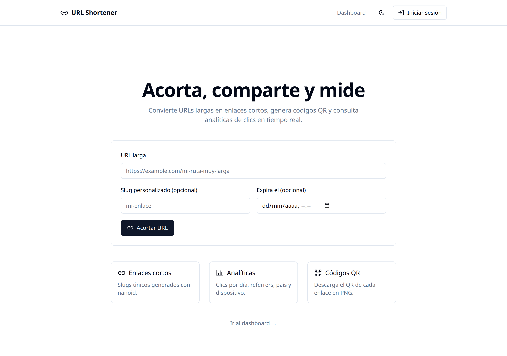
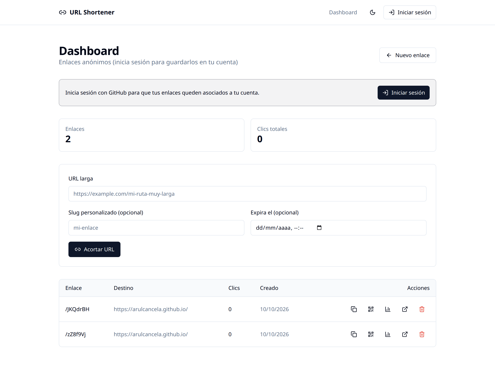
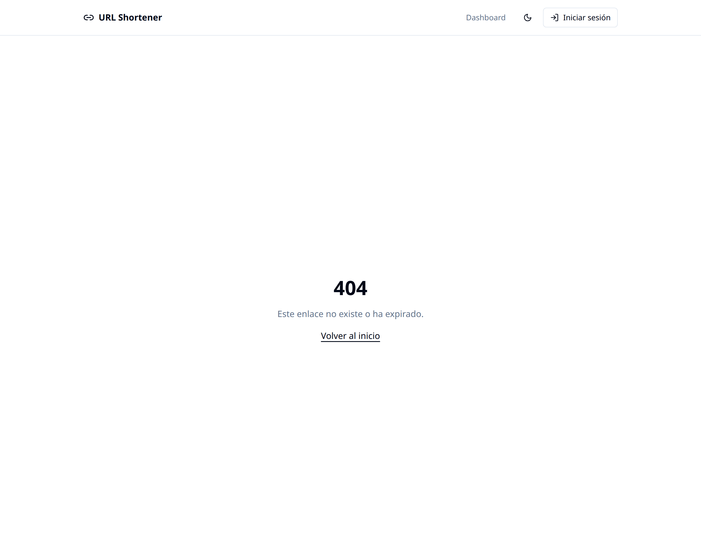
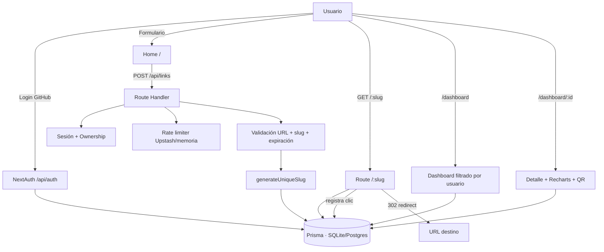

<div align="center">

# 🔗 URL Shortener

**Acortador de URLs con analíticas en tiempo real, códigos QR y autenticación.**

Construido con Next.js 14 (App Router), TypeScript estricto, Prisma y Tailwind CSS.
Desplegable en la **capa gratuita** de Vercel + Neon/Supabase.

[](https://github.com/arulcancela/url-shortener/actions/workflows/ci.yml)
[](https://vercel.com/new/clone?repository-url=https://github.com/arulcancela/url-shortener)
[](./LICENSE)
[](https://nextjs.org)
[](https://www.typescriptlang.org)
[](#-tests)

**[🚀 Ver demo en vivo](https://url-shortener-s35d.vercel.app)** · **[📸 Capturas](#-capturas)**

</div>

---

## 📸 Capturas

> Sustituye estos placeholders por capturas reales de tu deploy (recomendado: un GIF del flujo completo).

|         Home — crear enlace         |           Dashboard con analíticas            |
| :---------------------------------: | :-------------------------------------------: |
|  |  |

|    Detalle del enlace (gráficas + QR)    |   Flujo completo (GIF)   |
| :--------------------------------------: | :----------------------: |
|  |  |

---

## ✨ Características

- 🔗 **Creación de enlaces** con validación estricta de URL (formulario + API REST).
- 🧩 **Slug único con nanoid** (base62 sin caracteres ambiguos) y **custom slugs** opcionales.
- 🔐 **Autenticación con GitHub** (NextAuth). Los enlaces se asocian al usuario; el dashboard y las analíticas son privados. Sin sesión puedes crear enlaces anónimos.
- 🔀 **Redirección** en `/[slug]` con registro de clic: timestamp, referrer, user-agent, país y dispositivo.
- 📊 **Dashboard** con lista de enlaces, contadores de clics y acciones rápidas (copiar, QR, borrar).
- 📈 **Página de detalle** con gráfica de clics por día (Recharts), desglose por país/referrer y tabla de últimos accesos.
- 📱 **Códigos QR** generados en el cliente y descargables en PNG.
- ⏳ **Expiración opcional** de enlaces.
- 🚦 **Rate limiting por IP** con **Upstash Redis** (compartido entre instancias serverless) y _fallback_ a memoria.
- 🌗 **Modo claro/oscuro** persistente.
- 🧪 **41 tests unitarios** (Vitest) + **E2E** (Playwright) cubriendo el flujo completo.
- ⚙️ **CI/CD** con GitHub Actions: lint + typecheck + tests + build + E2E.
- 🎨 **UI** con Tailwind CSS + componentes shadcn/ui.

---

## 🧱 Stack

| Capa       | Tecnología                                    |
| ---------- | --------------------------------------------- |
| Framework  | Next.js 14+ (App Router) + React 18           |
| Lenguaje   | TypeScript strict (sin `any`)                 |
| UI         | Tailwind CSS + shadcn/ui + lucide-react       |
| Auth       | NextAuth (GitHub OAuth) + Prisma Adapter      |
| ORM / DB   | Prisma · SQLite (dev) · Postgres (prod)       |
| Slugs      | nanoid                                        |
| QR         | qrcode                                        |
| Gráficas   | Recharts                                      |
| Validación | zod (API) + validadores propios (dominio)     |
| Rate limit | Upstash Redis (opcional) / memoria (fallback) |
| Tests      | Vitest (unit) + Playwright (E2E)              |
| CI         | GitHub Actions                                |
| Deploy     | Vercel (+ Neon/Supabase para Postgres gratis) |

---

## 🏗️ Arquitectura



**Principios de diseño**

- **Lógica de negocio en `src/lib`**, no en los route handlers → testeable sin arrancar servidor.
- **Route handlers finos**: parsean (zod), validan, delegan a `lib/links.ts`.
- **Ownership en la capa de datos** (`getOwnedLinkById`): un usuario nunca ve enlaces de otro (404, no 403, para no filtrar existencia).

**Estructura**

```
url-shortener/
├─ prisma/            # schema.prisma (User/Account/Session/Link/Click) + seed
├─ src/
│  ├─ app/            # App Router: páginas, /[slug], /login, API routes
│  ├─ components/     # UI (shadcn) + componentes de negocio + auth
│  ├─ lib/            # lógica pura (slug, validación, rate limit, links, auth…)
│  └─ types/          # tipos compartidos + augmentations de NextAuth
├─ tests/             # unit/ (Vitest) y e2e/ (Playwright)
├─ .github/workflows/ # CI
└─ vercel.json
```

---

## 🧠 Decisiones técnicas

Documentadas por transparencia, priorizando lo más simple que siga siendo profesional.

1. **SQLite por defecto, Postgres en producción.** Garantiza `npm run dev` sin configuración. Un único schema; cambiar de motor es una línea (ver _Cambiar a Postgres_).
2. **API REST vía Route Handlers** en lugar de Server Actions: testeable con Playwright y consumible desde cualquier cliente.
3. **Alfabeto base62 sin caracteres ambiguos** (sin `0/O`, `1/l/I`), longitud 7 → ~1,7·10¹² combinaciones y enlaces legibles a mano.
4. **Validación de URL propia** además de zod: bloquea `javascript:`, `data:`, `file:`, `vbscript:`, `blob:`… y hosts locales/privados (anti-SSRF).
5. **Auth con sesión JWT + PrismaAdapter.** El `userId` se propaga en la sesión; los enlaces anónimos (`userId = null`) siguen permitidos.
6. **Ownership como 404, no 403**: no revelamos si un recurso ajeno existe.
7. **Rate limit con Upstash Redis** (atómico y compartido) y _fallback_ a memoria si no hay credenciales o Redis falla. No bloquea la creación si el backend cae.
8. **Clic registrado "best effort"**: si falla el `INSERT`, la redirección no se bloquea (prioridad: llegar al destino).
9. **País desde `x-vercel-ip-country`**: sin APIs de geo-IP de pago; en local será `null`.
10. **QR en cliente**: menos carga de servidor, sin almacenamiento, descarga directa.
11. **`force-dynamic` en el layout**: la app depende de la sesión, así que no se prerenderiza estáticamente.
12. **`next-auth` NO en `serverComponentsExternalPackages`**: externalizarlo rompe el runtime de React en el SSR (_Invalid hook call_). Documentado porque fue un bug real encontrado durante el desarrollo.

---

## 🚀 Cómo correr en local

Requisitos: **Node ≥ 20** y npm.

```bash
# 1. Clonar
git clone https://github.com/arulcancela/url-shortener.git
cd url-shortener

# 2. Instalar (también ejecuta `prisma generate`)
npm install

# 3. Variables de entorno
cp .env.example .env

# 4. Crear la base de datos SQLite
npm run db:push

# 5. (Opcional) Datos de ejemplo
npm run db:seed

# 6. Arrancar
npm run dev
```

Abre <http://localhost:3000>.

### Habilitar login con GitHub (opcional)

1. Crea una OAuth App en <https://github.com/settings/developers>.
   - **Homepage URL:** `http://localhost:3000`
   - **Authorization callback URL:** `http://localhost:3000/api/auth/callback/github`
2. Copia `Client ID` y `Client Secret` a tu `.env`:
   ```bash
   GITHUB_ID="tu-client-id"
   GITHUB_SECRET="tu-client-secret"
   NEXTAUTH_SECRET="$(openssl rand -base64 32)"
   NEXTAUTH_URL="http://localhost:3000"
   ```
3. Reinicia el servidor. Sin estas variables, la app funciona igualmente en **modo anónimo**.

---

## 🧪 Tests

```bash
# Unitarios (Vitest) — slugs, validación de URL, analítica, rate limit
npm run test          # 41 tests
npm run test:watch

# E2E (Playwright) — crear -> redirigir -> dashboard
npx playwright install --with-deps chromium   # solo la primera vez
npm run test:e2e
```

Playwright arranca el servidor de desarrollo automáticamente. Para usar uno ya levantado:
`PLAYWRIGHT_BASE_URL=http://localhost:3000 npm run test:e2e`.

---

## 🧾 Calidad de código

```bash
npm run lint          # ESLint (Next + TypeScript, sin `any`)
npm run typecheck     # tsc --noEmit
npm run format        # Prettier (escribe)
npm run format:check  # Prettier (comprueba)
```

---

## ☁️ Despliegue

Todo el proceso está detallado **paso a paso** en **[DEPLOY.md](./DEPLOY.md)** (Neon + Vercel + GitHub OAuth, todo en capa gratuita).

Resumen:

1. **Base de datos:** crea un Postgres gratis en [Neon](https://neon.tech).
2. **Cambia el provider de Prisma:** `npm run deploy:postgres`.
3. **Deploy en Vercel:** importa el repo y define las variables de `[.env.production.example](./.env.production.example)`.
4. **GitHub OAuth:** crea una OAuth App y añade `GITHUB_ID` / `GITHUB_SECRET`.
5. **(Opcional)** Upstash Redis para rate limiting compartido.

> Para volver a SQLite en local: `npm run deploy:sqlite`.

---

## 🔌 API

| Método   | Ruta                    | Auth     | Descripción                                  |
| -------- | ----------------------- | -------- | -------------------------------------------- |
| `POST`   | `/api/links`            | opcional | Crea un enlace (rate limit por IP).          |
| `GET`    | `/api/links`            | opcional | Lista los enlaces del usuario (o anónimos).  |
| `GET`    | `/api/links/:id`        | —        | Detalle de un enlace propio + últimos clics. |
| `DELETE` | `/api/links/:id`        | —        | Elimina un enlace propio (clics en cascada). |
| `GET`    | `/api/links/:id/clicks` | —        | Serie diaria de clics (`?days=30`).          |
| `GET`    | `/:slug`                | —        | Redirige y registra el clic.                 |

```bash
curl -X POST http://localhost:3000/api/links \
  -H "Content-Type: application/json" \
  -d '{"url":"https://example.com","customSlug":"demo"}'
```

---

## 🔒 Seguridad

- Validación estricta de URLs (bloqueo de esquemas peligrosos y hosts privados → anti-SSRF).
- Ownership verificado en cada operación sobre un enlace.
- Rate limiting por IP (Upstash Redis) en la creación de enlaces.
- Cabeceras de seguridad (`X-Content-Type-Options`, `X-Frame-Options`, `Referrer-Policy`).
- Secretos gestionados por variables de entorno; `.env` ignorado por git.

---

## 🔭 Mejoras futuras

- Enlaces por equipo/organización y roles.
- Etiquetas, carpetas y búsqueda en el dashboard.
- Dominio corto personalizado.
- Detección de códigos maliciosos (Google Safe Browsing).
- Exportación de analíticas a CSV y tarea de retención de clics.
- Notificaciones de enlaces que expiran pronto.

---

## 📄 Licencia

MIT — ver [LICENSE](./LICENSE).
